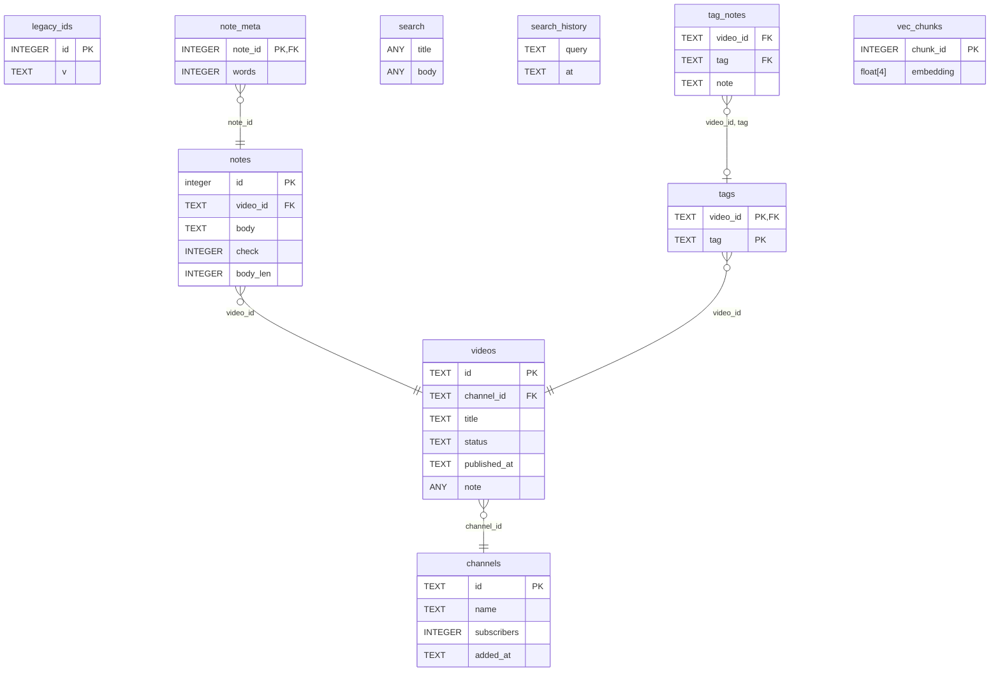

<!-- Generated by github.com/trick77/ship/kit/schemadoc, do not edit. Regenerate in the Go module directory: SCHEMADOC_UPDATE=1 go test ./... -run TestSchemaDoc -->

# Database schema

10 tables; the diagram is at the end. Go types are the `model.go` structs whose rows they hold.

## channels

Go types:

- `channels.Channel` (channels): Channel is one row of the channels table. Subscribers is 0 when the count is hidden.
- `channels.legacyRow` (channels): legacyRow is unexported and still listed, with its unexported fields; a blank field is not.

| Column | Type | Null | Default | PK |
| --- | --- | --- | --- | --- |
| `id` | TEXT | yes |  | 1 |
| `name` | TEXT | no |  |  |
| `subscribers` | INTEGER | no | `0` |  |
| `added_at` | TEXT | yes |  |  |

## legacy_ids

| Column | Type | Null | Default | PK |
| --- | --- | --- | --- | --- |
| `id` | INTEGER | yes |  | 1 |
| `v` | TEXT | yes |  |  |

## note_meta

| Column | Type | Null | Default | PK |
| --- | --- | --- | --- | --- |
| `note_id` | INTEGER | no |  | 1 |
| `words` | INTEGER | yes |  |  |

Foreign keys:

- `note_id` → `notes` (`id`), on delete CASCADE

## notes

| Column | Type | Null | Default | PK |
| --- | --- | --- | --- | --- |
| `id` | integer | no |  | 1 |
| `video_id` | TEXT | no |  |  |
| `body` | TEXT | no |  |  |
| `check` | INTEGER | yes |  |  |
| `body_len` | INTEGER | yes | `generated: length(body)` |  |

Foreign keys:

- `video_id` → `videos` (`id`)

Checks:

- `CHECK (body <> ')' AND length(body) > 0)`
- `CHECK ("check" BETWEEN 1 AND 5)`

## search

Virtual table: `fts5(title, body)`.

| Column | Type | Null | Default | PK |
| --- | --- | --- | --- | --- |
| `title` |  | yes |  |  |
| `body` |  | yes |  |  |

## search_history

| Column | Type | Null | Default | PK |
| --- | --- | --- | --- | --- |
| `query` | TEXT | no |  |  |
| `at` | TEXT | no | `CURRENT_TIMESTAMP` |  |

Indexes:

- `sqlite_autoindex_search_history_1` (`query COLLATE NOCASE`) unique

## tag_notes

| Column | Type | Null | Default | PK |
| --- | --- | --- | --- | --- |
| `video_id` | TEXT | yes |  |  |
| `tag` | TEXT | yes |  |  |
| `note` | TEXT | yes |  |  |

Foreign keys:

- `video_id`, `tag` → `tags` (`video_id`, `tag`)

## tags

Go types:

- `tags.Tag` (videos/tags): Tag is one row of tags.

| Column | Type | Null | Default | PK |
| --- | --- | --- | --- | --- |
| `video_id` | TEXT | no |  | 1 |
| `tag` | TEXT | no |  | 2 |

Foreign keys:

- `video_id` → `videos` (`id`), on delete CASCADE

## vec_chunks

Virtual table: `vec0(chunk_id integer primary key, embedding float[4])`.

| Column | Type | Null | Default | PK |
| --- | --- | --- | --- | --- |
| `chunk_id` | INTEGER | no |  | 1 |
| `embedding` | float[4] | yes |  |  |

## videos

Go types:

- `channels.Video` (channels): Video is one row of videos, declared in a group.

| Column | Type | Null | Default | PK |
| --- | --- | --- | --- | --- |
| `id` | TEXT | yes |  | 1 |
| `channel_id` | TEXT | no |  |  |
| `title` | TEXT | no |  |  |
| `status` | TEXT | no | `'new'` |  |
| `published_at` | TEXT | yes |  |  |
| `note` |  | yes | `'a\|b'` |  |

Foreign keys:

- `channel_id` → `channels` (`id`), on delete CASCADE

Indexes:

- `idx_videos_channel` (`channel_id`, `published_at DESC`)
- `idx_videos_new` (`status`) where `status = 'new'`
- `idx_videos_recent` (`channel_id`, `coalesce(published_at, ')') COLLATE NOCASE DESC`) where `title <> ''`
- `idx_videos_title` (`lower(title)`) unique

## Views

- `recent_videos` (view)

## Types not stored as rows

### channels.Stats

In `channels`. Stats is computed per request, never stored.

| Field | Type | Doc |
| --- | --- | --- |
| `Count` | `int` | Count is the number of videos, hidden ones included. |
| `Since` | `string` | trailing comment |

## Diagram

